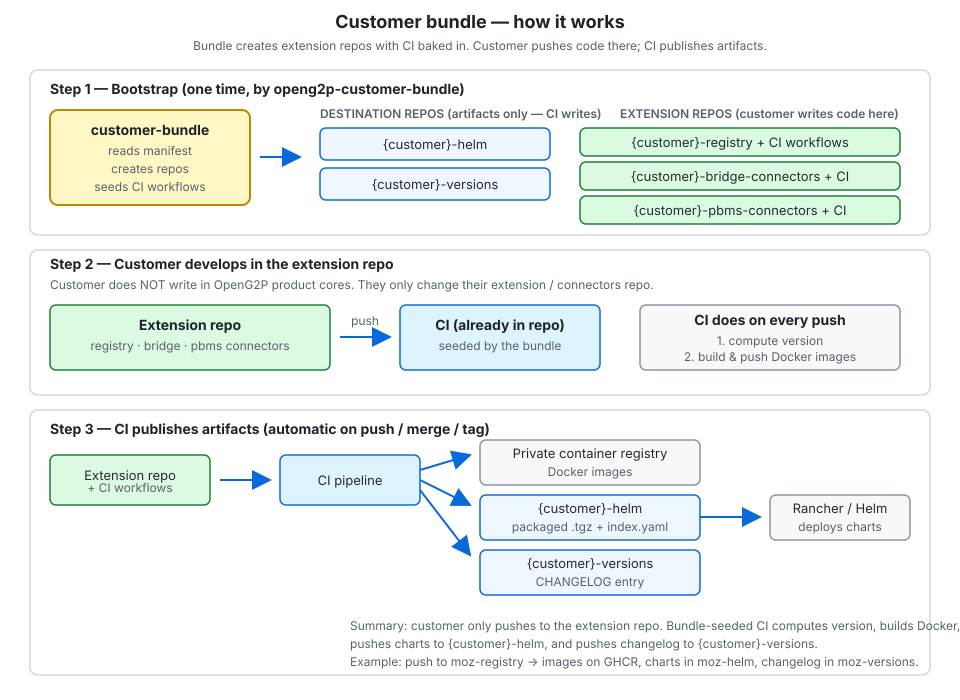
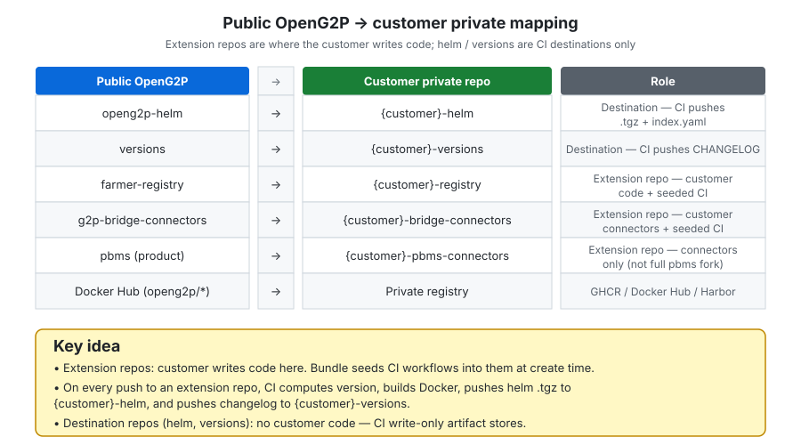
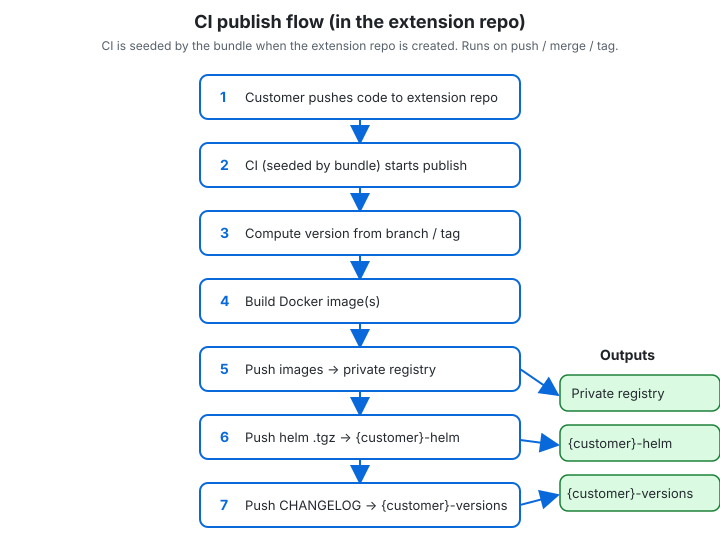
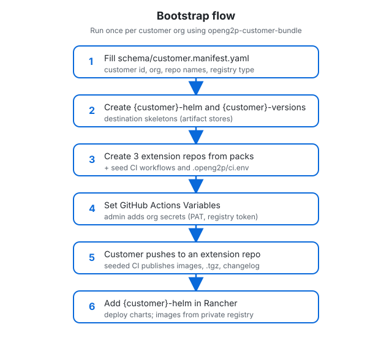

# OpenG2P Customer Bundle — Design Draft v1

Bootstrap private packaging destinations and **extension repos** so a customer can
extend Registry, PBMS, and Bridge the same way OpenG2P does publicly — without
publishing customer artifacts to the public internet.

The customer writes code only in the extension repos created by this bundle.
Each extension repo is created with CI already seeded; on every push the pipeline
computes a version, builds Docker images, pushes helm charts to `<customer>-helm`,
and pushes the changelog to `<customer>-versions`.

**Status:** Design only. Implementation follows after this draft is approved.

---

## 1. Purpose

`openg2p-customer-bundle` is a **bootstrapper + template pack**. It does not hold
customer domain code. It creates and wires:

| Artifact | Public OpenG2P analogue | Customer private analogue |
|----------|-------------------------|---------------------------|
| Packaged Helm charts (`.tgz`) | [openg2p-helm](https://github.com/OpenG2P/openg2p-helm) | `<customer>-helm` |
| Version / changelog history | [versions](https://github.com/OpenG2P/versions) | `<customer>-versions` |
| Registry manifestation | [farmer-registry](https://github.com/OpenG2P/farmer-registry/tree/1.2) | `<customer>-registry` |
| Bridge connectors | [g2p-bridge-connectors](https://github.com/OpenG2P/g2p-bridge-connectors) | `<customer>-bridge-connectors` |
| PBMS connectors | Same shape as bridge; product is [pbms](https://github.com/OpenG2P/pbms) | `<customer>-pbms-connectors` |
| Container images | Docker Hub `openg2p/*` | Private registry |

### Non-goals (v1)

- Writing customer domain logic or connector implementations beyond stubs
- Deploying clusters or configuring Rancher beyond documenting how to consume the helm repo
- Forking OpenG2P platform / product cores (`registry-platform`, `g2p-bridge`, `pbms`)
- SPAR pack (deferred)
- GitLab host support (deferred; GitHub first)

---

## 2. Locked decisions

1. **Helm and versions stay separate repos** in draft 1 (merge later if useful).
2. **`<customer>-helm` stores packaged `.tgz` charts**, same idea as `openg2p-helm` —
   **not** chart source. No public website / Pages publish; Rancher or Helm consume
   the private git repo.
3. **One extension / connectors repo per product** (registry, PBMS, bridge).
4. **This repo = bootstrapper + packs only** — not live customer code.

---

## 3. Topology

```text
Customer private org
├── <customer>-helm                 # destination: .tgz packages (+ index.yaml), CI-pushed
├── <customer>-versions             # destination: per-service CHANGELOG, CI-pushed
├── <customer>-registry             # extension repo (customer code + seeded CI)
├── <customer>-bridge-connectors    # extension repo (customer code + seeded CI)
└── <customer>-pbms-connectors      # extension repo (customer code + seeded CI)

Private container registry
└── ghcr.io/<org>/*  |  Docker Hub private  |  Harbor

openg2p-customer-bundle             # templates + bootstrap (OpenG2P-owned)
```

### 3.1 Architecture overview



**Read this as three steps:**

1. **Bootstrap (once)** — `openg2p-customer-bundle` creates 5 private repos: 2
   **destination** repos (`helm`, `versions`) and 3 **extension** repos
   (`registry`, `bridge-connectors`, `pbms-connectors`). Extension repos are
   created with CI workflows and `.openg2p/ci.env` already in place.
2. **Develop (ongoing)** — the customer writes code **only** in the extension
   repos (not in OpenG2P product cores, and not in helm/versions).
3. **Publish (automatic on push)** — the seeded CI in the extension repo
   computes the version, builds Docker images, pushes charts to
   `{customer}-helm`, and pushes the changelog to `{customer}-versions`.

### 3.2 Public OpenG2P vs customer mapping



**One row per repo type** — left is the public reference, right is what the
customer gets. Destination repos (helm, versions) are CI write-only.
Extension repos hold customer code **and** the CI that publishes on every push.
---

## 4. Destination repos

### 4.1 `<customer>-helm` — packaged charts only

**Mirrors:** [OpenG2P/openg2p-helm](https://github.com/OpenG2P/openg2p-helm) (artifact layout).

**Does not contain:** chart source (`Chart.yaml` trees, templates). Those live in
extension repos and are packaged by the extension-repo CI.

**Contains (after CI publishes):**

```text
<customer>-helm/
  README.md
  index.yaml                          # regenerated on each publish (same as public)
  <chart>-<version>.tgz               # e.g. moz-registry-0.0.0-develop.12.tgz
  ...
```

**Diff vs public `openg2p-helm`:**

| | Public | Customer |
|---|--------|----------|
| Content | `.tgz` + `index.yaml` | Same |
| Visibility | Public + GitHub Pages website | **Private git only** — no public Pages site |
| Who writes | Product / extension CI bot | Extension-repo CI bot (seeded by the bundle) |
| How Rancher uses it | `https://openg2p.github.io/openg2p-helm` | Point Rancher/Helm at the **private repo** (authenticated git or internal HTTP that serves the same files) |

Chart **source** stays in the extension repo (e.g. `helm/openg2p-<slug>/` like
farmer-registry). On push, the seeded CI runs `helm package` and commits the
`.tgz` (and updates `index.yaml`) into `<customer>-helm`.

### 4.2 `<customer>-versions` — changelog history

**Mirrors:** [OpenG2P/versions](https://github.com/OpenG2P/versions).

Per-service folder written by CI:

```text
<customer>-versions/
  index.md                            # optional index of services
  <customer>-registry/
    CHANGELOG.md
    .meta
    versions/                         # per-version detail pages if used by CI
  <customer>-bridge-connectors/
    CHANGELOG.md
    .meta
    versions/
  <customer>-pbms-connectors/
    CHANGELOG.md
    .meta
    versions/
```

Same contract as public: one immutable published version per successful publish;
changelog is the source of truth for what changed.

Reuse OpenG2P changelog publish scripts; only remap **target repo** via env
(`VERSIONS_REPO`).

---

## 5. Prodcut extension repos (where the customer writes code)

These repos are created by the bundle. They are **not** OpenG2P product cores.
The customer implements their domain / connectors here. Each pack includes CI
workflows by default so a push automatically publishes version, Docker, helm,
and changelog.

### 5.1 Registry — shape of [farmer-registry `@1.2`](https://github.com/OpenG2P/farmer-registry/tree/1.2)

Customer builds a **manifestation** of `registry-platform` (not a fork of the
platform) in their extension repo.

```text
<customer>-registry/
  .github/workflows/                  # seeded by bundle: docker + helm-publish + changelog
  docker/                             # FROM openg2p/openg2p-registry-* + install extension
  <slug>-extension/                   # domain package (models, schemas, seed, …)
  helm/openg2p-<slug>/                # chart source (wrapper or full — match farmer model)
  scripts/                            # e.g. bump platform pin lockstep
  test/
  .openg2p/ci.env                     # non-secret destinations for CI (from manifest)
  README.md
```

| Path | Role |
|------|------|
| `<slug>-extension/` | Customer domain code |
| `docker/` | Thin images: platform base + extension |
| `helm/.../` | Chart **source** → packaged to `<customer>-helm` as `.tgz` by CI |
| `.github/workflows/` | Seeded by the bundle — runs on every customer push |
| CI outputs | Images → private registry; `.tgz` → helm; changelog → versions |

Platform image tags and chart dependency pins stay lockstep (same idea as farmer
`RP_VERSION`).

### 5.2 Bridge — shape of [g2p-bridge-connectors](https://github.com/OpenG2P/g2p-bridge-connectors)

Customer does **not** fork `g2p-bridge` core. They own a private connectors repo
(reference layout = public connectors repo).

```text
<customer>-bridge-connectors/
  .github/workflows/
  bank-connectors/                    # or customer-named packages
  mapper-connectors/
  notification-connectors/
  geo-resolver/
  agency-allocator/
  warehouse-allocator/
  # + any customer-only connector packages
  docker/                             # optional: derived Bridge Celery image(s)
  helm/                               # if they publish connector-related charts; else image-only
  .openg2p/ci.env
  README.md
```

Public pattern to preserve in the pack docs:

1. Implement connector interfaces in this repo (or thin packages).
2. Build derived image `FROM openg2p/openg2p-bridge-celery:<ver>`.
3. Select impl via Bridge config env (`G2P_BRIDGE_*_IMPL` / `*_IMPLS`).
4. Deploy with standard Bridge chart; override Celery image to the private one.

Scaffold includes stub connector(s) **and seeded CI** that, on push, builds/pushes
a derived image, packages helm if present, and records changelog under
`versions/<customer>-bridge-connectors/`.

### 5.3 PBMS — connectors repo (bridge-like); product is [pbms](https://github.com/OpenG2P/pbms)

- **Product** `pbms` (apis/core/deployment/docker/…) stays OpenG2P-owned — customer
  does not scaffold a full PBMS fork.
- **Customer work** = registry (and related) **connectors**, in a repo shaped like
  bridge connectors (public PBMS connectors repo TBD; pack anticipates that shape).

```text
<customer>-pbms-connectors/
  .github/workflows/
  registry-connector/                 # primary customer extension point
  # other connector packages as PBMS defines them
  docker/                             # derived image(s) FROM published PBMS images
  helm/                               # only if packaging overlays/charts
  .openg2p/ci.env
  README.md
```

Same operational model as Bridge: private connectors + derived images + config
selection; core PBMS chart/images remain upstream unless overlay charts are needed.

---

## 6. What `openg2p-customer-bundle` contains

```text
openg2p-customer-bundle/
  docs/
    design.md                         # this document
  schema/
    customer.manifest.yaml            # normative example + field comments
    customer.manifest.schema.json     # optional JSON Schema (later)
  destinations/                       # (implementation) empty skeletons
    helm/
    versions/
  packs/                              # (implementation) extension-repo templates (+ CI)
    registry/
    bridge-connectors/
    pbms-connectors/
  bootstrap/                          # (implementation) create repos, push packs, set CI vars
```

Destination skeletons, packs, and bootstrap are **out of scope for this design
check-in**; they are the implementation phase.

---

## 7. CI contract (seeded into every extension repo)

The bundle copies CI workflows into each extension repo at create time. The
customer does not set up packaging CI themselves.

When the customer pushes changes to an extension repo (reuse OpenG2P packaging
workflows/scripts where possible):

```text
on push / merge / tag to the extension repo
  1. Compute version (same OpenG2P versioning rules)
  2. Build & push Docker image(s) → private registry
  3. helm package chart source → commit .tgz + refresh index.yaml → <customer>-helm
  4. Generate/append changelog → commit → <customer>-versions/<service>/
```

### 7.1 Publish flow



Every extension repo runs the same seeded publish pipeline on push:
compute version → build → push image → push helm `.tgz` to `{customer}-helm` →
push changelog to `{customer}-versions`.

Chart **source** stays in the extension repo; only the packaged `.tgz` lands in
`<customer>-helm`. Changelog text lands only in `<customer>-versions`.

### Non-secret (`.openg2p/ci.env` + GitHub Variables)

| Variable | Example | Purpose |
|----------|---------|---------|
| `CUSTOMER_ID` | `moz` | naming |
| `PACKAGING_REF` | `v1` | pin shared CI scripts |
| `HELM_REPO` | `moz-openg2p/moz-helm` | `.tgz` publish target |
| `HELM_BRANCH` | `main` | branch holding packages (not a public Pages site) |
| `VERSIONS_REPO` | `moz-openg2p/moz-versions` | changelog target |
| `VERSIONS_BRANCH` | `develop` | match public versions default |
| `CONTAINER_REGISTRY` | `ghcr.io/moz-openg2p` | image push |
| `IMAGE_PREFIX` | `moz` | image names |

No requirement for a public `HELM_URL` / GitHub Pages. If `index.yaml` needs a URL
for Helm clients, use an authenticated or internal base URL configured per customer.

### Secrets (org-level)

| Secret | Purpose |
|--------|---------|
| `OPENG2P_BOT_GITHUB_PAT` | push to helm + versions; clone private deps |
| Registry credentials | push images (GHCR may use same PAT) |

---

## 8. Manifest

Bootstrap is driven by a single file the implementer fills once. Normative example:
[`schema/customer.manifest.yaml`](../schema/customer.manifest.yaml).

---

## 9. Bootstrap flow

1. Fill `customer.manifest.yaml`.
2. Bootstrap creates `<customer>-helm` and `<customer>-versions` from destination skeletons.
3. Bootstrap creates **extension repos** from packs, including seeded CI workflows and `.openg2p/ci.env`.
4. Sets Actions variables from the manifest; prints org secret checklist.
5. Customer pushes code to an extension repo → seeded CI publishes images, `.tgz`, and changelog.
6. Customer points Rancher/Helm at private `<customer>-helm`.



Run the bootstrap tool once per customer. After that, the customer only works in
extension repos; packaging is automatic via the seeded CI.

---

## 10. Mapping summary (public → customer)

| Concern | Public reference | Customer private |
|---------|------------------|------------------|
| Registry extension repo | `farmer-registry` | `<customer>-registry` (code + seeded CI) |
| Bridge connectors extension | `g2p-bridge-connectors` | `<customer>-bridge-connectors` (code + seeded CI) |
| PBMS connectors extension | *(like bridge; product = `pbms`)* | `<customer>-pbms-connectors` (code + seeded CI) |
| Chart packages (destination) | `openg2p-helm` (`.tgz`) | `<customer>-helm` (CI-only, no public site) |
| Changelogs (destination) | `versions` | `<customer>-versions` (CI-only) |
| Images | Docker Hub | Private registry |
| Orchestration | — | `openg2p-customer-bundle` |

---

## 11. Defaults for Draft v1

| Topic | Default |
|-------|---------|
| Container registry | GHCR in customer org |
| Helm branch name | `main` (same file layout as public `gh-pages`, without Pages) |
| Versions branch | `develop` |
| SPAR | Out of scope |
| Git host | GitHub only |
| PBMS pack fidelity | Mirror bridge-connectors until official PBMS connectors repo exists |
| Bridge chart publish | Image + changelog first; chart `.tgz` only if pack includes `helm/` |
| Repo naming | `<customer>-bridge-connectors`, `<customer>-pbms-connectors` (not `<customer>-bridge`) |

---

## 12. Implementation phases (after design freeze)

1. Destination skeletons (`destinations/helm`, `destinations/versions`)
2. Registry pack end-to-end (proves docker + helm `.tgz` + changelog)
3. Bridge-connectors and PBMS-connectors packs
4. Bootstrap CLI / scripts (`create`, `update-vars`, `add-connector`)
5. Hardening: path filters, frozen tags, secret checklist, runbook

---

## 13. References

- [farmer-registry `@1.2`](https://github.com/OpenG2P/farmer-registry/tree/1.2)
- [g2p-bridge-connectors](https://github.com/OpenG2P/g2p-bridge-connectors)
- [pbms](https://github.com/OpenG2P/pbms)
- [openg2p-helm](https://github.com/OpenG2P/openg2p-helm)
- [versions](https://github.com/OpenG2P/versions)
- [OpenG2P versioning & CI](https://docs.openg2p.org/operations/deployment/helm-docker-versioning-and-ci)
- [Registry codebase organization](https://docs.openg2p.org/products/registry/registry/developer-zone/organization-of-codebase)
